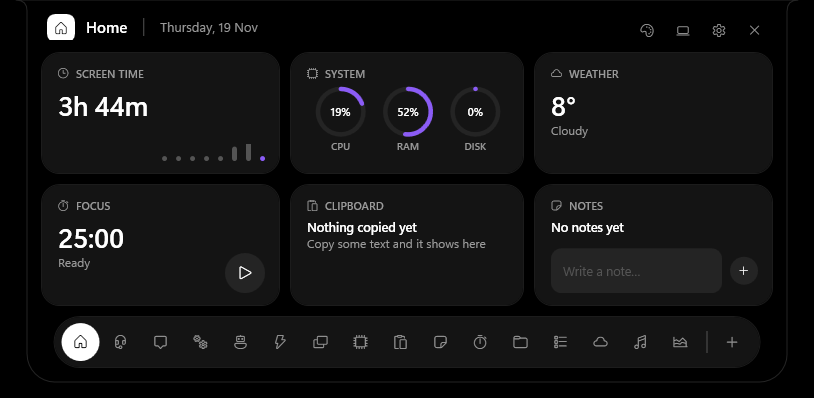
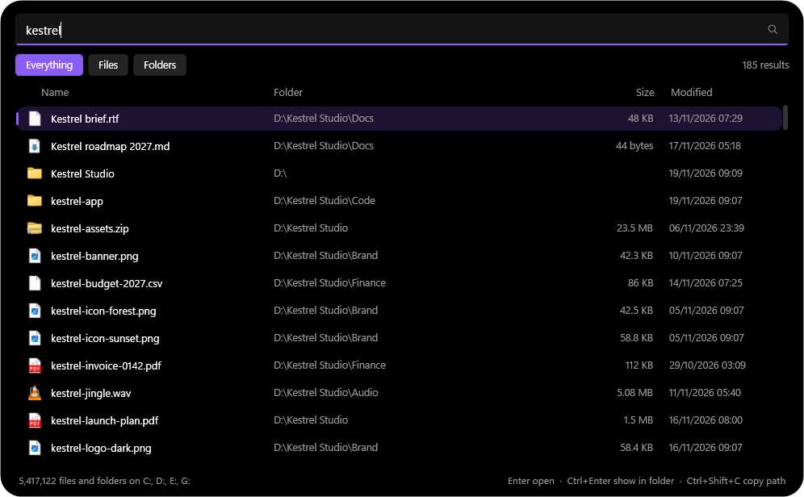
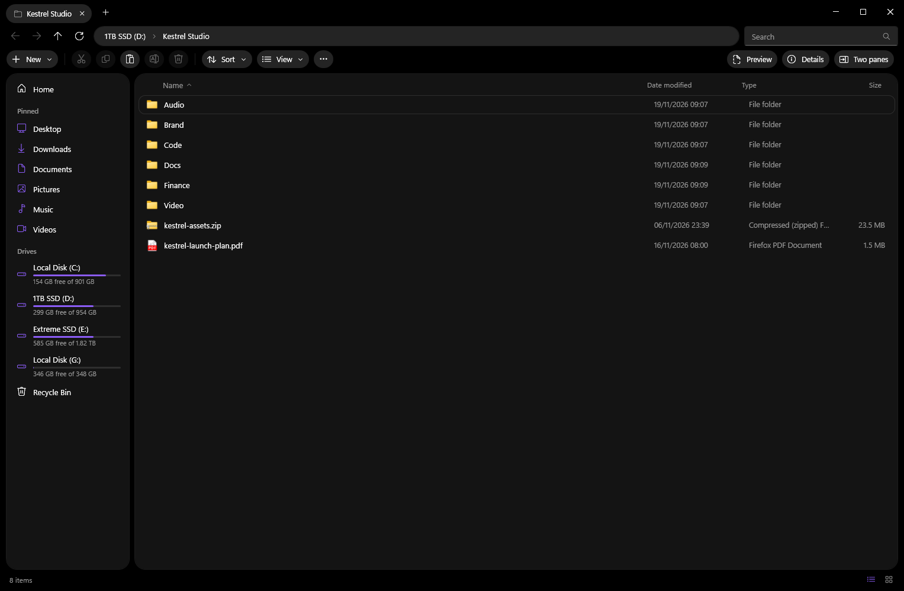
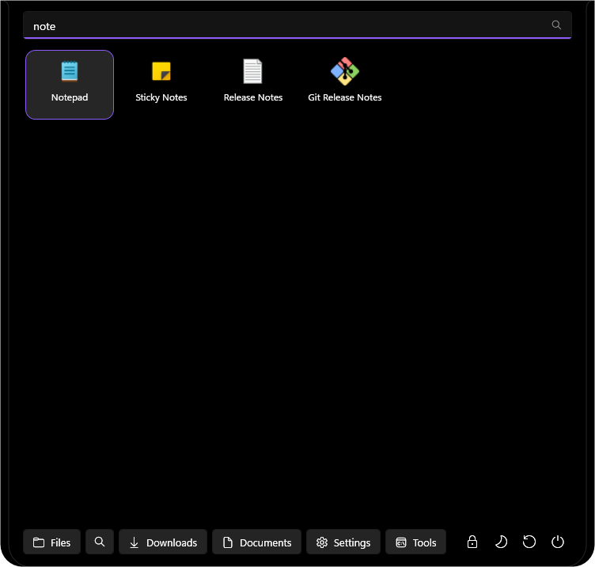

# DeskShell

A Windows 11 shell of its own: the taskbar is replaced by a **notch** at the top of the screen that grows into a Home panel, with an app drawer for a Start menu, instant file search across every drive, a file explorer, a Task Manager, Alt+Tab, snap zones and a game mode that gets out of the way. Everything is in one dark, rounded style, and none of it needs administrator rights.



| Search files: every file on every drive, as you type | The file explorer |
|---|---|
|  |  |

| App drawer (tap the Windows key) |
|---|
|  |

## Install it

Needs Windows 10 (2004) or 11 and the [.NET 10 desktop runtime](https://dotnet.microsoft.com/download/dotnet/10.0). Build it, then install:

```
.\build-release.ps1
dist\DeskShell.exe --install
```

This copies DeskShell to `%LOCALAPPDATA%\Programs\DeskShell` (no admin needed) and adds it to the Start menu and to Settings → Apps → Installed apps, where you can uninstall it. Settings → *Install DeskShell* does the same from a running copy. Uninstalling keeps your settings in `%APPDATA%\DeskShell`.

Or run it from source without installing: `dotnet run --project src/DeskShell`.

**Getting the normal taskbar back:** `Ctrl+Alt+Shift+Q`, or the ✕ in the shell. If DeskShell crashes or is ended, a small watchdog process brings the taskbar back. DeskShell never changes the Windows taskbar's own settings (such as auto-hide): it only hides the taskbar window and reserves screen space, and gives both back when it quits. To keep the Windows taskbar on screen alongside DeskShell, use the switch in Settings.

**Updates:** put a GitHub repository (`owner/name`) in Settings → *Update from GitHub repo*. DeskShell checks its latest release once a day; when a release tagged with a newer version (e.g. `v1.1.0`) has a `.zip` attached, an *Update* button appears in the shell, which downloads it, quits DeskShell, installs the new version and starts it. To publish one: bump `<Version>` in `src/DeskShell/DeskShell.csproj`, run `build-release.ps1`, and attach `release\DeskShell-<version>.zip` to a release tagged `v<version>`. With no repository set, nothing is checked.

## Optional parts

DeskShell is the notch (or the classic island), the drawer, the shell, Alt+Tab and the window tools. Everything else is optional: DeskShell works without it, and each part has a switch in Settings → General (or does nothing until you connect it).

| Part | Default | What happens when it's off |
|---|---|---|
| **File explorer** (Win+E) | On | Win+E, the drawer's folder links and "show in folder" use Windows' File Explorer. Opening *every* folder in DeskShell's explorer is a separate switch, off by default. |
| **Task Manager** (Ctrl+Shift+Esc) | On | Ctrl+Shift+Esc and the Tools menu open Windows' Task Manager. |
| **Search files** (Alt+F) | On | No index is kept (switching it off deletes it) and Alt+F is left to apps. The hotkey can be changed or cleared. |
| **Sage** (the author's PCAssistant voice assistant) | On, only if it's installed | DeskShell doesn't connect to it and its notch tab goes. Without PCAssistant installed there's nothing to switch off. |
| **Claude Code** | Not connected | Nothing is changed in Claude Code until you press *Connect Claude Code*, which adds DeskShell's hooks (and *Disconnect* removes them). |
| **Discord calls and DMs** | Waiting for the plugin | Needs the AIChat Vencord plugin (`deskshell.ts`) in Discord; without it the call page and Discord notifications simply never appear. |
| **Voicemeeter** | Used if installed | The mixer tile shows Windows' own outputs only. |

## Look

One theme for everything DeskShell draws (the notch, drawer, shell, explorer, Task Manager, settings): presets *Black*, *Graphite*, *Light* and *Windows* (follows Windows' light or dark mode), with Windows' accent colour or your own colours on top. Changes apply live.

## What's in it

**Notch** (the island's default look): a small black clock against the top edge of the screen, its edges slowly breathing in a colour you pick. Rest the mouse on it (or press `Alt+Space`) and it grows into **Home**: cards for screen time today, CPU / memory / disk, weather, a focus timer, what's playing and quick notes, with a tab bar for bigger views of each plus Files, Apps and Music. The palette button in its header picks the edge-glow and panel colours and turns breathing on or off; **+** on the tab bar chooses which tabs show. While a focus timer runs, the notch shows the time left. New notifications (and Discord DMs and mentions) pop out of the notch for a few seconds, and so does each new song, with its cover and back / play-pause / next buttons; Settings → Island can switch off Windows' own banners for every app while DeskShell runs (each app's previous setting is restored when DeskShell quits). Screen time and notes stay on this PC (`%APPDATA%\DeskShell\screentime.json`, `notes.json`). Other programs can open Home by setting the `DeskShell.ToggleHome` event. Settings → Island switches back to the classic pill below.

**Notifications in the notch**: the **Notifications** tab lists Windows' recent notifications and unread Discord DMs and mentions, newest first, with the apps they came from on the left (click one to see only its own). Click a notification to open it (Discord at the message, other apps by starting them); middle-click or right-click → *Hide* takes it off the list, and **Clear** takes everything off. Windows doesn't let other apps dismiss its notifications, so they stay in Windows' own list, which the tab can open. It also has Windows' Do Not Disturb switch, and clicking a notification that pops out of the notch opens this tab.

**Background apps in the notch**: the **Background apps** tab shows the tray icons the taskbar would (Discord, Steam, OneDrive…) as cards with each app's name and status. Clicking one is the same as clicking its tray icon: left-click usually opens the app, right-click shows its menu (Quit, Settings…).

**Claude in the notch**: a little blob with a visor lives at the right of the closed notch. Its eyes follow the mouse, it blinks, scans while Claude Code is working, turns yellow with a "!" when Claude needs your OK, and hops when a job finishes (poke it three times quickly and it gets dizzy). The **Claude** tab lists your Claude Code sessions (desktop app, terminals, IDEs) and lets you **Allow**, **Always** allow, **Deny** or answer **In Claude** when Claude asks for permission; requests also pop out of the notch. If you don't answer within 45 seconds, Claude asks in its own window as usual. The right side is a plain chat with Claude, using your Claude subscription through the `claude` command; it has no tools and can't see or change files. Watching sessions needs **Connect Claude Code** (in the tab or Settings → Claude Code), which adds DeskShell's hooks to `%USERPROFILE%\.claude\settings.json` after backing it up; the same button disconnects. Inspired by [coucou](https://github.com/Louis-CFM/coucou); the pet is our own design.

**Sage in the notch** (optional): if Sage (PCAssistant, the author's own voice assistant) is installed and switched on in Settings, the **Sage** tab talks to it over the same private pipe its own window uses (your Windows account only, plus Sage's access token). It shows Sage as an orb that changes colour with what it's doing, has a mic button, switches for the wake word, spoken replies and starting Sage's window hidden, and lets you allow or deny what Sage asks for. The chat on the right goes into your latest Sage conversation (New chat starts one called "Notch"); things you say out loud show up there too. With the notch closed, Sage pops out of it when it hears its name, with what you said and then its answer as it comes in, and with anything it needs your OK for. **Open Sage's window** brings up Sage's full app. Sage keeps running as its own app; DeskShell just reconnects whenever it's there. Settings → General switches the connection and the tab off.

**Island, classic pill** (top of the main monitor): a black pill, like Apple's Dynamic Island, that never grows past its size. **‹ ›** or the mouse wheel flip between four pages:

- **Notifications**: the latest one and how many there are, including unread Discord DMs and direct mentions (from the AIChat Vencord plugin). Click a Discord message to open it in Discord, anything else for Windows' notification centre
- **Music**: what's playing, with previous / play-pause / next
- **Open windows**: their icons; click to switch, click again to minimise, right-click to pin, minimise or close
- **Programs**: your pinned apps, files and folders; drag files onto the island to pin them
- **Voice call** (while you're in a Discord call): the channel and everyone in it; whoever's speaking glows. Sent by the AIChat Vencord plugin (`deskshell.ts`) to DeskShell on `127.0.0.1:47390`, which only accepts Discord's own pages.

**Double-click the island** and it grows into the shell (and shrinks back into it when the shell closes). It hides while a fullscreen or borderless window (a game, a video) fills its monitor, and maximised windows sit below it. Settings → Island can put one on every monitor or stop reserving the space. Its size, look, pages, peek mode, notification moments and the shell's animation are designed in Island Workshop (`design/island-workshop.html`, open it in a browser): press *Copy settings* there, then *Paste from Island Workshop* in DeskShell's settings (or run `DeskShell.exe --apply-island <file.json>`).

The old **dock** at the bottom is still there if you want it (Settings → Dock); it's off by default now.

**App drawer** (tap the Windows key, the all-apps button on the island, *All apps* in the shell, or `Alt+Shift+Space`): DeskShell's Start menu. Search, pinned, recent and every app A-Z, plus Files, Search files, Downloads, Documents, Settings and power buttons. Works by keyboard alone: type to search, arrows to move, Enter to open, Ctrl+Shift+Enter to run as administrator, Esc to close. **Tools** (a button in the drawer and the shell, or right-click the island's all-apps button) has Terminal, Command Prompt and PowerShell, each also as administrator, plus Task Manager, Services, Device Manager, Disk Management, Event Viewer, Network Connections, Registry Editor and Run. Windows-key shortcuts still work, and during games the key goes back to Windows. Settings > General turns the Windows-key part off.

**Task Manager** (optional; `Ctrl+Shift+Esc`, or Task Manager in Tools): DeskShell's own, in the island's style. Processes are grouped by app into Apps, Background processes and Windows processes, with CPU, memory, I/O and GPU per app (click a column to sort, the arrow or a double-click to see each process). Delete or *End task* ends the selection; Windows' own processes ask for a second click, and ones running as administrator go through Windows' permission prompt. *Performance* graphs CPU, memory, disk, network and GPU over the last minute, and *Startup apps* turns programs that start with Windows on and off. It only measures while it's open. Settings > General switches back to Windows' Task Manager, which is also used during fullscreen games and if DeskShell stops responding; Ctrl+Alt+Del's Task Manager is always Windows'.

**File explorer** (optional; `Win+E`, File Explorer in Tools, or Files, Downloads and Documents in the drawer): DeskShell's own, in the island's style, with tabs, a sidebar of pinned folders and drives, and Home (pinned folders, drives with free space, recent files). Folders show as a details list or as thumbnail tiles (pictures and videos open as tiles), and the address bar, back/forward/up, filtering as you type, and Enter to search all subfolders work as you'd expect. Copy, move and delete use Windows' own progress window, Recycle Bin and conflict questions; drag files in and out, cut/copy/paste with other apps, F2 to rename, Ctrl+T/W for tabs. Right-click gives a short menu, and *Show more options* (or Shift+right-click) Windows' full menu with everything apps add to it. It runs in its own background process (`DeskShell.exe --files`), so a crashing shell extension can't take the island down and windows open instantly. Settings > General switches Win+E back to Windows' File Explorer, and can also make Windows open every folder (desktop, other apps) in DeskShell's; turning that off puts back whatever opened folders before.

**Search files** (optional; `Alt+F`, the search button in the app drawer, Alt+Enter in the drawer or the explorer's search box, or `Ctrl+Shift+F` in the explorer): every file and folder on every fixed NTFS drive, like voidtools' Everything. Type part of a name and matches appear as you type, sorted by name, usually within a few dozen milliseconds even across millions of files. Words must all appear in the name, in any order; `"two words"` is a phrase, `!word` leaves out, `jpg|png` is either, `*.log` or `report??.docx` are wildcards against the whole name, `ext:jpg;png` filters by extension, `file:` / `folder:` (or the chips) show only one kind, and anything with a `\` is matched against the whole path (`projects\ readme`). Click a column to sort by name, folder, size or date (size, date and folder sorts are offered up to 250,000 results). Enter opens, Ctrl+Enter shows it in its folder in DeskShell's explorer, Space is Quick Look, Ctrl+Shift+C copies the path, Delete recycles; right-click gives the explorer's menu (Windows' own, with Open with, Send to, 7-Zip…), and results drag out to anything that takes files. It closes when you click elsewhere and opens again on the screen the mouse is on, with your last search. The Recycle Bin's contents are left out.

How it works: the index lives in the explorer's background process, so the shell itself stays small. It needs **no administrator rights**. Drives Windows lets any user open (usually data drives) are read straight from their Master File Table in seconds; the system drive can't be read that way without admin, so its folders are walked once instead, reading every entry's file ID as it goes (about half a minute for 3 million entries, at background CPU and disk priority, and paused while a game runs). Each drive's index is then saved to `%LOCALAPPDATA%\DeskShell\search` and kept current from the drive's USN change journal, which every user may read; on the next start only the changes since are read, so it's ready in a couple of seconds. New, renamed, moved and deleted files show up within about a second. A file with several names (hard links, as in `Windows\WinSxS`) is listed once, under its non-WinSxS name. Memory: names are stored once each in a compact pool with a few small arrays per entry, about 35 bytes per file all in (around 200 MB for 5.4 million files); drives without a change journal are re-read once a day. Settings > General turns it off (which deletes the index) and sets the hotkey (`Alt+F` takes over that key in every app, where it usually opens the File menu; pick another there if you miss it).

**Shell** (double-click the island, or `Alt+Space`): type to search and launch any app. Tiles below, all movable and resizable with **Customise**:

| Tile | Notes |
|---|---|
| Pinned apps | Right-click a search result → Pin |
| Wi-Fi / network, Bluetooth | Click toggles, right-click opens Windows settings |
| Do not disturb | Windows' own Do Not Disturb (the same switch as in Settings → Notifications) |
| Dark mode | Switches Windows light/dark |
| Volume, Sound output | Output switches the default device for everything |
| Mixer | One row per output: Voicemeeter's VAIO, AUX and VAIO3 (their Voicemeeter faders) and any other device apps play through (its Windows volume). Right-click an output to show its apps, each with its own volume. Below: Voicemeeter's A/B outputs |
| Brightness | Laptop screens, and external monitors that support DDC/CI |
| Now playing | Whatever Windows sees playing (Spotify, browsers…) |
| CPU / memory / GPU | Updates every second while the shell is open |
| Weather | Set your city in settings (Open-Meteo) |
| Calendar, Screenshot, Window layout | |
| Clipboard history | Last 30 texts you copied, memory only; password managers' copies are skipped |
| Notifications | Read-only copy of Windows' recent notifications |
| Background apps | Your tray icons |

Plus Lock / Sleep / Restart / Shut down (restart and shut down need a second click).

**Open windows** sit either side of the shell: Monitor 1's windows in a panel on its left, Monitor 2's on its right (underneath the shell on narrow screens). Windows are grouped by app, each as a preview card with its full title. The window you were using is outlined. Click to switch, hover for ×, middle-click to close, right-click for Pin to dock / Minimise / Close.

**Games**
- The *Games* tile lists every installed game with box art where the launcher has it: Steam (all libraries), Epic, the Xbox app / Game Pass, and games registered by Battle.net, Ubisoft, EA, Riot and Rockstar. Click to play; games also show up in shell search.
- **Game mode**: while something runs fullscreen, DeskShell turns on Do Not Disturb (only if it wasn't already on, and switches it off again afterwards), closes the shell, pauses its background checks and frees memory. It ends 5 seconds after you leave the game. Both parts can be switched off in settings.

**Windows**
- **Alt+Tab**: DeskShell's own switcher with live previews, most recent first. Windows' own Alt+Tab is used while a fullscreen game runs.
- **Show all windows** (`Ctrl+Alt+Up`, or the button in the shell): every window side by side. Click to switch, middle-click or × to close.
- **Snap zones**: hold **Shift** while dragging a window, drop it on a zone. Each monitor has its own layout (pick in settings or with the Window layout tile). Gaps are adjustable.
- **App rules**: e.g. "Discord always opens on monitor 2, zone 1".
- **Reopen apps where they were**: window positions are remembered across restarts.
- **Active window border**: coloured border on the focused window (Windows 11).

## Settings

The gear in the shell opens the settings window. Everything is also in `%APPDATA%\DeskShell\settings.json`. Window positions are kept in `window-positions.json` next to it. Log: `%LOCALAPPDATA%\DeskShell\deskshell.log`.

For bug hunting, create an empty file named `debug` in `%LOCALAPPDATA%\DeskShell` and restart DeskShell: ManagedShell's detailed log then goes to `managedshell.log` there. Delete the file when done (that log grows quickly).

"Start DeskShell when I sign in" is off until you turn it on.

**Recovery:** if Explorer restarts, a monitor is plugged in or changes resolution, or the PC wakes from sleep, DeskShell rebuilds its docks, hides the taskbar again and asks tray apps to re-add their icons.

## Known limits

- Notifications can't be dismissed from the tile (Windows doesn't allow it); the button opens Windows' notification center.
- Clipboard history keeps text only, not images.
- Search files only sees folders your Windows account can open on the system drive (other users' profiles and a few system folders are skipped), and indexes fixed NTFS drives only (not USB sticks, network drives or FAT/exFAT).

## Built with

C# / .NET 10 / WPF and [ManagedShell](https://github.com/cairoshell/ManagedShell) (window tracking, tray icons, hiding the Windows taskbar).

## License

[MIT](LICENSE). ManagedShell, which DeskShell builds on, is under its own license (Apache 2.0).
